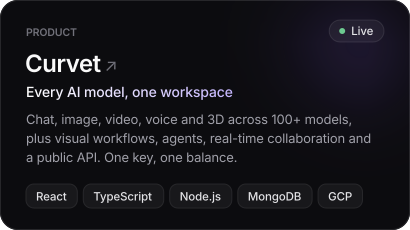
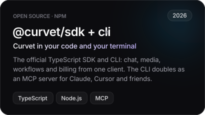
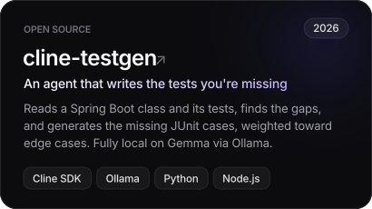
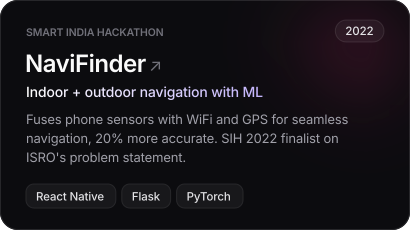
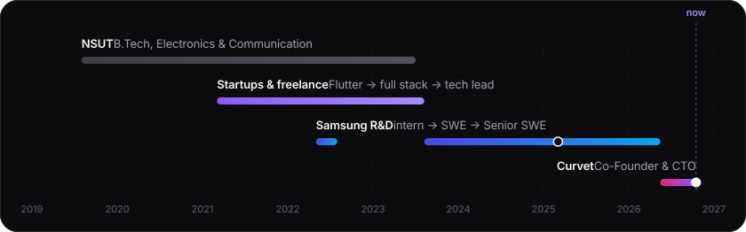

<a href="https://curvet.ai"></a>

<p align="center">
  <a href="https://curvet.ai"></a>
  <a href="https://utkarshg.is-a.dev"></a>
  <a href="https://linkedin.com/in/utkarshgupta2504"></a>
  <a href="https://x.com/Utkarsh2504"></a>
  <a href="https://www.npmjs.com/package/@curvet/sdk"></a>
  <a href="mailto:utkarshgupta2504@gmail.com"></a>
</p>



<br>

### Building Curvet

[Curvet](https://curvet.ai) puts every major model for chat, image, video, voice and 3D behind one interface, one API key and one balance. I built it from zero and run engineering: the model router, the workflow engine, the agent runtime, voice, billing, and the infra under all of it.

<a href="https://curvet.ai"></a>

<details>
<summary><b>Try it from your terminal</b></summary>
<br>

```bash
npm i -g @curvet/cli
curvet chat -m auto "who is utkarsh?"
```



The CLI also runs as an MCP server (`curvet mcp`), so Claude, Cursor and other agents can use Curvet as a tool. SDK: [`@curvet/sdk`](https://www.npmjs.com/package/@curvet/sdk).

</details>

<br>

### Selected work

<p align="center">
  <a href="https://curvet.ai"></a>
  <a href="https://github.com/Curvet-in/curvet-sdk"></a>
  <a href="https://github.com/utkarshgupta2504/cline-testgen"></a>
  <a href="https://github.com/pragati-kumar/NaviFinder-Hackerchiefs"></a>
</p>

<details>
<summary><b>Earlier projects</b></summary>
<br>

| | | |
|---|---|---|
| [**NSUTx**](https://github.com/zenghost1/NSUTx) | My university portal, rebuilt as an app. 10K+ downloads on Google Play. | Flutter · Firebase |
| [**ConnectX**](https://github.com/pranjaljain584/ConnectX) | Video conferencing with chat, file sharing and a shared whiteboard. | React · WebRTC · Socket.io |
| [**Sensus**](https://github.com/samartharoraa/Sensus) | A journal that senses your mood, 85%+ accurate over 1,000+ entries. | React · NLP · AWS |

</details>

<br>

### The path so far



<details>
<summary><b>Curvet</b> · Co-Founder & CTO · 2026 – now</summary>
<br>

- One interface, API key and credit balance across 100+ models from 28 providers.
- "Auto" model selection over a scored registry (quality, strengths, live price) with cross-provider fallback chains, so a failing provider degrades to a working answer instead of an error.
- A visual workflow builder whose run-time core is one module executed by both the browser and a headless server runner, so the two can't drift.
- An agent runtime with tiered, search-loaded tools and prompt caching, cutting the fixed prompt overhead of a simple request by more than half.
- The developer platform: an OpenAI-compatible API used from Cline and OpenCode, plus `@curvet/sdk`, `@curvet/cli` and an MCP server.
- Indian-language speech recognition and TTS, and a self-hosted voice engine with cloning.
- Production on GCP with tracing end to end (OpenTelemetry, Grafana, PostHog), a load-test harness and a ~350-file backend test suite.

</details>

<details>
<summary><b>Samsung R&D Institute</b> · SWE → Senior SWE · 2023 – 2026</summary>
<br>

- Next-Gen Connectivity: machine learning for the Galaxy Multi-Device Experience.
- Cut on-device network switching latency 3x with a deep-learning approach.
- Built internal automation that took 30% off the team's workload.
- Cross-device connectivity features used by 10M+ Galaxy users. Promoted to Senior in 2025.

</details>

<details>
<summary><b>Startups & freelance</b> · Flutter → full stack → tech lead · 2021 – 2023</summary>
<br>

- **Shakespeare AE**, Member of Technical Staff: rebuilt the Flutter app on a custom design system (40% less duplication), moved the backend from Hasura to Node + MongoDB (25% faster APIs), and built a full restaurant PoS on one real-time socket backend.
- **MyEra**, Technical Lead: a personalization engine embedded by 10+ retail brands through iframes with two-way postMessage callbacks.
- **Kalpas Innovations**, Core Developer: a Flutter dating app with video calls and geo matchmaking; crashes down 50%.
- Plus Wyden, Naxome, Blobdesign and Humming Sparrow, and a summer at Samsung R&D on speech enhancement with GANs.

</details>

<br>

### Stack



<br>

### On GitHub

<p align="center">
  
  
</p>
<p align="center">
  
</p>

<details>
<summary><code>$ curvet --whoami --json</code></summary>
<br>

```json
{
  "name": "Utkarsh Gupta",
  "role": "Co-Founder & CTO @ Curvet",
  "based_in": "Bengaluru, India",
  "previously": ["Senior SWE @ Samsung R&D", "Flutter + full stack @ startups"],
  "building": ["model routing", "agent runtimes", "voice", "the apps on top"],
  "ask_me_about": ["LLM infra", "MCP", "shipping fast with a small team"],
  "wins": [
    "Smart India Hackathon 2022 finalist (ISRO)",
    "12th of 6,700 at CodeJitsu, IIT Guwahati",
    "Won EduThon, IIIT Lucknow, against 600+ teams"
  ],
  "resume": "https://utkarshg.is-a.dev/Utkarsh_Gupta_Resume.pdf"
}
```

</details>

<br>

<a href="https://curvet.ai"></a>

<!-- Images in assets/ are generated: edit scripts/build.py and re-run it. -->
